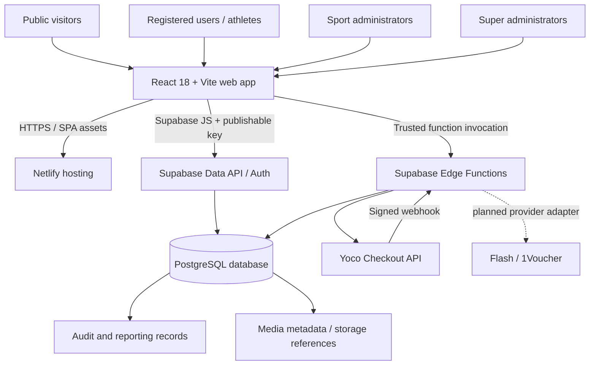

# CUT Sport App — System Architecture & Technical Blueprint

**Document type:** System architecture and technical blueprint  
**Repository:** `siphenda-hue/CUTSportAppRep`  
**Working branch:** `App`  
**Application:** CUT Sport  
**Architecture review date:** 18 November 2026  
**Status:** Baseline architecture documented; portability controls and several integrations are target-state requirements, not claims of completed implementation.

---

## 1. Purpose and architecture principles

This document describes the current CUT Sport application and the target architecture needed to operate it as a secure, maintainable institutional sports platform.

The system supports public sports information and heritage records, registered users and athletes, sport-specific operations, super-administration, content publishing, team management, commerce, event ticketing, reporting and future integrations.

### 1.1 Non-negotiable principles

1. **CUT owns its data.** The institution must be able to export and restore its operational data without depending on a proprietary dashboard.
2. **PostgreSQL is the durable data foundation.** Keep the core schema, constraints, indexes, views, functions and migrations as portable PostgreSQL wherever practical.
3. **Provider independence.** Supabase, Netlify, Yoco and Flash are replaceable infrastructure/providers, not the owners of CUT Sport business rules.
4. **Security is enforced server-side.** Frontend role checks improve navigation; database policies and trusted backend services enforce access.
5. **Public heritage remains available.** Anonymous visitors can read approved current-season and previous-season information, plus approved historical/heritage records. Private athlete, staff, operational and payment data remain protected.
6. **Auditable operations.** Important approvals, publishing, payment transitions, ticket redemption and administrative actions must be traceable.
7. **Incremental migration.** Infrastructure can be replaced in stages, with tested backups and rollback plans, rather than a high-risk rewrite.
8. **Implemented and planned capabilities are labelled separately.** A repository file or design plan is not proof that a provider integration has been activated in production.

---

## 2. System context and deployment topology

### 2.1 Current logical topology



The browser is an untrusted environment. It may hold only public configuration and the Supabase publishable key. It must never receive a database password, Supabase service-role/secret key, payment secret, webhook signing secret or ticket-signing secret.

### 2.2 Current infrastructure inventory

| Layer | Current choice | Notes |
|---|---|---|
| Source control | GitHub | Repository `siphenda-hue/CUTSportAppRep`, branch `App` |
| Web application | React 18, Vite 6 | Single-page application |
| Routing | React Router 6 | Browser-based routes |
| UI icons | Lucide React | Component icon library |
| Browser data client | Supabase JS 2.119.0 | Direct browser-to-Supabase data access under RLS |
| Database | Supabase-managed PostgreSQL | Project ref `tnkykdfxzwaqzbichxcl`, region recorded as `sa-east-1` in project documentation |
| Server functions | Supabase Edge Functions | Deno-style provider/runtime functions |
| Hosting | Netlify | `netlify.toml` defines Vite build, SPA fallback and headers |
| Payments | Yoco Checkout | Server-created checkout and signed webhook architecture |
| Additional payments | Flash / 1Voucher | Merchant-contract-dependent; planned, not represented as live |
| CI | GitHub Actions | Build validation has passed; does not alone prove full end-to-end readiness |

**Live hosting note:** The published site is `https://cutsportapp.netlify.app`. The latest operational notice supplied during development stated that published sites remain live while production deploys and Agent Runners are paused because operational credits are exhausted. This is an account/billing state, not an application architecture feature. Do not trigger deployments or change billing as part of this document.

### 2.3 Key repository paths

- `src/main.jsx` — React entry point, BrowserRouter, error boundary and service-worker registration.
- `src/App.jsx` — current application shell, route declarations, major screens and shared client state.
- `src/components/BottomNav.jsx` — reusable bottom navigation component.
- `src/lib/api.js` — public and authenticated data-access helpers.
- `src/lib/supabase.js` — Supabase client construction and browser environment configuration.
- `supabase/migrations/` — versioned SQL schema, policy, function and data migrations.
- `supabase/functions/` — trusted server-side functions.
- `supabase/tests/` — database/security tests.
- `docs/` — permission model, deployment readiness, features, integration plans and implementation notes.
- `netlify.toml` — hosting build configuration, SPA fallback, caching and security headers.
- `.env.example` — public build-time Supabase URL and publishable-key placeholders.

---

## 3. Frontend architecture

### 3.1 Technology stack

- React 18.3.1
- Vite 6.4.1
- React Router DOM 6.28.0
- Supabase JS 2.119.0
- Lucide React 0.468.0
- Node.js 22 for the configured Netlify build environment

Versions are pinned in `package.json` and `package-lock.json`.

### 3.2 Current structure and evolution target

The current application is a React single-page application. `main.jsx` mounts the app, installs BrowserRouter and an error boundary, and registers the production service worker. `App.jsx` currently contains the main application shell, data-loading logic, auth/session state and many screen components. The API helper centralises common table queries, while the Supabase client is initialised in one library module.

This is the actual current structure; it should not be mistaken for a fully separated feature-package architecture. As the application grows, progressively extract modules without changing behaviour in one large rewrite.

**Recommended target structure:**

```text
src/
  app/
    App.jsx
    router.jsx
    providers/
    guards/
  components/
    layout/
    navigation/
    forms/
    feedback/
    data-display/
  features/
    home/
    sports/
    teams/
    athletes/
    competitions/
    seasons/
    fixtures/
    statistics/
    heritage/
    news/
    events/
    shop/
    checkout/
    tickets/
    profile/
    notifications/
    sponsors/
    team-hub/
    administration/
    reports/
  services/
    auth/
    sports/
    commerce/
    payments/
    media/
    notifications/
  adapters/
    database/
    supabase/
  lib/
    config/
    validation/
    formatting/
  styles/
```

The target is an incremental refactor, not a prerequisite to keep the current app running.

### 3.3 Routing and access areas

React Router owns client-side navigation. The application should keep route definitions central and apply route guards for signed-in-only and administrator-only screens. A route guard is a user-experience control only; it must never be treated as the security boundary.

Application modules include:

- Public home, sport directory and sport hubs.
- Teams, staff, athlete profiles and approved athlete records.
- Competitions, fixtures, results, standings, squads and statistics.
- Current and previous seasons, plus curated heritage archives.
- International appearances, honours and season achievements.
- News/articles, sponsors and events.
- Product catalogue, product detail, cart, checkout and order history.
- Event ticket types, ticket wallet, staff ticket gate and redemption.
- User profile, notifications and athlete communication.
- Administration workspaces for sport operations, teams/staff, rosters, athlete approvals, editorial, recruitment, media, international appearances, Team Hub and reporting.

### 3.4 Frontend state and data access

The current frontend uses React state/effects and local storage for the shopping cart. Public data is loaded through functions in `src/lib/api.js`. Auth session state is obtained through Supabase Auth. Realtime subscriptions are used for notification badge refresh.

Target improvements:

- Keep presentation components free of direct provider-specific database calls.
- Use feature-level service functions and typed/validated response shapes.
- Add pagination and explicit loading, empty, partial-failure and retry states.
- Do not silently convert configuration or permission errors into empty business data.
- Keep cart contents as a convenience only; prices, stock and order totals must be recalculated by the trusted server.
- Keep sensitive/private athlete and staff information out of public client queries.
- Introduce a provider-neutral service boundary before any database or authentication migration.

---

## 4. Backend architecture

### 4.1 Supabase services in the current backend

Supabase currently provides several distinct services:

- **PostgreSQL:** relational records, constraints, indexes, functions, views and transaction processing.
- **Data API:** browser-accessible database access through the Supabase client, constrained by grants and Row Level Security.
- **Authentication:** user identity, sessions and JWTs.
- **Edge Functions:** trusted application endpoints for privileged workflows and external provider communication.
- **Realtime:** database change subscriptions used by selected live UI elements.
- **Storage:** a potential/current platform capability for media; storage buckets and object inventory must be explicitly included in a migration inventory before moving infrastructure.

### 4.2 Current Edge Function inventory

The repository contains these function areas:

| Function | Responsibility |
|---|---|
| `yoco-checkout` | Creates a server-authoritative Yoco checkout for an authorised order |
| `yoco-webhook` | Validates signed Yoco webhook events and reconciles payment state |
| `my-tickets` | Returns the signed-in user's ticket records |
| `redeem-ticket` | Performs protected ticket validation and one-time redemption |
| `event-report` | Returns scoped event sales, inventory and attendee reporting |
| `manage-shop-order` | Supports trusted shop-order management operations |

Function behaviour and deployment status must be checked against source and the target Supabase project before a production release. Function code in GitHub is the source artefact; deployed function versions and secrets are separate operational state.

### 4.3 Backend API boundaries

The target backend should expose business operations rather than make the browser responsible for sensitive multi-step workflows.

Examples:

- Create checkout / request payment.
- Receive and verify payment-provider callback.
- Issue event ticket after verified payment.
- Redeem ticket exactly once.
- Retrieve a user's own tickets and orders.
- Publish an approved fixture result atomically.
- Approve/reject athlete profile or record submissions.
- Export a scoped report.
- Send notifications through a trusted notification service.

Each operation must validate the authenticated identity, role, resource scope, payload, state transition and idempotency requirements. The backend must not accept a browser-submitted claim that a payment succeeded.

### 4.4 Provider-neutral backend target

Introduce internal interfaces such as:

- `PaymentProvider`: create payment, verify callback, retrieve status, refund/reverse where supported.
- `IdentityProvider`: authenticate, resolve identity, refresh/revoke session and map external subject to CUT user ID.
- `ObjectStorageProvider`: upload, read, delete and sign access to media.
- `NotificationProvider`: send email, push or other approved delivery.
- `ReportingService`: query authorised reporting datasets and generate exports.

Supabase Edge Functions can implement these interfaces initially. A future Node.js service, another serverless platform or a containerised API can implement the same contracts without changing the business rules or frontend feature modules.

---

## 5. Database architecture

### 5.1 Database foundation

The current database is PostgreSQL managed by Supabase. The public schema contains the application domain tables, with relationships implemented through primary keys, foreign keys, unique constraints, indexes, views, triggers and SQL functions.

**Portability rule:** keep business entities and their relationships in standard PostgreSQL. Supabase-specific objects should be isolated, documented and replaceable.

Avoid making the app dependent on undocumented dashboard-only configuration or manual changes that do not exist in version control.

### 5.2 Current domain model

The current public table inventory is grouped below by domain. This is a domain map, not a claim that every table is fully populated or exposed to every user.

**Identity, profiles and permissions**
- `profiles`
- `user_roles`
- `sport_admin_profiles`
- `sport_admin_assignments`
- `sport_admin_activity_logs`
- `player_profile_claims`

**Sports, teams and athlete identity**
- `sports`
- `teams`
- `team_staff_profiles`
- `athletes`
- `player_profiles`
- `athlete_team_memberships`
- `athlete_media`
- `athlete_achievements`
- `athlete_competitions`
- `athlete_statistics`
- `athlete_review_history`
- `athlete_data_quality_reviews`
- `athlete_data_quality_review_history`
- `athlete_player_profile_link_audit`
- `athlete_messages`

**Competitions, fixtures and performance**
- `competitions`
- `competition_squads`
- `competition_squad_members`
- `competition_matches`
- `competition_standings`
- `competition_player_statistics`
- `competition_team_statistics`
- `competition_honours`
- `fixtures`
- `fixture_result_submissions`
- `player_match_statistics`
- `player_match_statistics_review_history`
- `player_international_appearances`
- `player_awards`

**Team Hub and coaching operations**
- `team_hub_seasons`
- `team_hub_season_members`
- `team_hub_fixture_attendance`
- `team_hub_practice_attendance`
- `team_hub_player_availability`
- `team_hub_player_development_notes`
- `team_hub_posts`
- `team_hub_polls`
- `team_hub_poll_options`
- `team_hub_poll_responses`
- `team_hub_media_assets`
- `team_hub_social_content`
- `coach_action_tasks`
- `coach_action_task_history`

**Recruitment and trials**
- `recruitment_opportunities`
- `trial_applications`
- `trial_application_reviews`
- `trial_evaluation_criteria`
- `trial_application_scores`

**Editorial, events and engagement**
- `articles`
- `article_comments`
- `events`
- `event_rsvps`
- `event_ticket_types`
- `notifications`
- `report_export_history`

**Commerce, payments and ticketing**
- `products`
- `orders`
- `order_items`
- `tickets`
- `yoco_webhook_events`

**Sponsors**
- `sponsors`

### 5.3 Principal relationships and data flows

- A sport has teams, competitions, staff, fixtures and sport-specific administration assignments.
- A team belongs to a sport and can be associated with competitions, fixtures, staff and season records.
- A competition belongs to a sport and contains matches, standings, squads and player/team statistics.
- Squad members and player statistics should link to a canonical player identity where possible.
- `player_profiles` is the long-term player identity/heritage record; `athletes` supports athlete operations and public athlete-card workflows. Their linkage must be explicit and audited to avoid duplicate people.
- International appearances and awards link to player profiles, sports and, where applicable, competitions.
- A Team Hub season belongs to a team and sport; its membership, availability, attendance, posts, polls, development notes, media and tasks belong to that season or its members.
- Events have ticket types. Orders contain order items. Verified successful payment can issue tickets. A ticket is redeemed through a trusted one-time operation.
- Notifications are associated with a user and may reference a related record.
- Administrative assignments scope staff to sports and/or teams. Audit records preserve important administrative actions.

### 5.4 Historical and heritage records

Historical results must not be modelled as disposable current-season content. Retain competition and season identifiers, source references, verification metadata, result status, match-level records, team/player statistics and correction/audit history.

Public access policy should allow:
- Current season data.
- Previous season data (the immediately preceding year).
- Specifically approved heritage records, including international representation, season wins, Varsity Netball, Varsity Football, Varsity Cup and other verified competition history.

This access must be read-only for public visitors. Private athlete data, internal review notes, private staff records and operational notes must remain protected. Public views should expose only fields approved for public display.

### 5.5 Canonical identity and data quality

The database currently has both `athletes` and `player_profiles`. Do not solve gaps by creating duplicate athlete identities. Use a stable canonical profile ID and explicit audited links. Where historic source data has uncertain identity, preserve the source name and verification status until an authorised reviewer confirms the match.

### 5.6 Data migration and backup strategy

The database must be restorable independently of Supabase:

- Version all schema changes in `supabase/migrations/` and maintain a clean, ordered migration history.
- Use standard PostgreSQL SQL for tables, constraints, indexes, views and business logic wherever practical.
- Maintain repeatable seed/reference data separately from production-only records.
- Create encrypted logical backups using PostgreSQL-native tools (for example, `pg_dump` in custom or plain SQL format); retain database roles/grants and extension inventory separately.
- Export media objects separately from the database and preserve their object keys/metadata.
- Back up authentication identity mappings and document the process for credential reset or identity-provider transition. Password hashes and provider-managed credentials may not be exportable in a portable form.
- Keep secrets outside SQL dumps, GitHub and application bundles.
- Perform scheduled restore drills to a clean PostgreSQL instance, not just successful backup creation.
- Record backup timestamp, database version, schema/migration version, extension list, object-storage inventory and checksum.
- Define recovery point objective (RPO) and recovery time objective (RTO) with CUT before production launch.

A database dump alone is not a full application backup: it does not automatically move Supabase Auth users/sessions, Storage objects, Edge Function deployments, secrets, scheduled jobs, Realtime configuration, DNS, hosting or external payment credentials.

---

## 6. Authentication and security architecture

### 6.1 User classes

| User class | Expected access |
|---|---|
| Public / anonymous visitor | Public sports, current and previous seasons, approved heritage, published news, public teams/fixtures/competitions, sponsors and public event/product information |
| Registered user | Public access plus own profile, own notifications, own orders and own tickets; athlete self-service where enabled |
| Sport administrator | Only the sports and teams explicitly assigned; scoped operations, approvals, publishing and reporting according to granted capabilities |
| Super administrator | Institution-wide configuration and administration, including administrator assignment and cross-sport oversight |

A user may have more than one role or assignment. Permissions must be evaluated as a combination of role, active assignment, sport/team scope and action capability.

### 6.2 Current security mechanisms

- Supabase Auth provides user sessions.
- `profiles` stores application profile data.
- `user_roles` stores application roles.
- `sport_admin_profiles` and `sport_admin_assignments` support administrator identity and scope.
- PostgreSQL Row Level Security (RLS), grants and server-side function checks enforce access.
- Browser environment uses `VITE_SUPABASE_URL` and `VITE_SUPABASE_PUBLISHABLE_KEY`.
- Privileged secrets belong only in protected Edge Function secrets.
- Administrative and sensitive workflows use audit/history tables where implemented.

### 6.3 Required authorization controls

- Never trust user-editable profile metadata for privilege decisions.
- Never expose a service-role or database secret to the browser.
- Apply least-privilege grants and RLS to every exposed table.
- For updates, enforce both row visibility and valid post-update ownership/scope.
- Ensure views do not unintentionally bypass RLS; use security-invoker views where supported or keep sensitive views in non-exposed schemas.
- Keep private reviewer notes, internal comments, personal identifiers and payment details out of public response payloads.
- Use server-side checks for payment, ticket issuance/redemption, privileged exports and cross-user access.
- Use idempotency keys and unique constraints for checkout and webhook processing.
- Record administrator approvals, role changes and sensitive state transitions.
- Test policies as anonymous, ordinary authenticated, athlete, assigned sport admin, unassigned sport admin and super administrator.

### 6.4 Authentication portability

Supabase Auth is currently the identity provider, but it must not become the permanent business identity model.

For portability:
1. Keep a stable internal CUT user UUID in application-owned tables.
2. Maintain a separate identity mapping of internal user ID to provider name and provider subject ID.
3. Avoid using Supabase Auth user IDs as the only cross-system identifier in imported/exported business records.
4. Keep roles and sport/team assignments in application-owned relational tables, not solely in provider-specific user metadata.
5. Define account linking, password reset, MFA, session revocation and identity verification procedures for a provider change.
6. Expect users may need to reset passwords or re-enrol MFA when leaving a managed identity service; do not promise password-hash portability.

---

## 7. Sports management and heritage data

The sports domain is the core of CUT Sport. It must support multiple sporting codes, teams and categories, multiple competitions per season, multi-sport athletes, team staff, player identity, fixtures, results, statistics, honours and historical archives.

### 7.1 Operational data flow

1. An authorised administrator creates or updates a sport/team/competition within their assigned scope.
2. Team membership and staff assignments are recorded with effective dates/seasons.
3. Fixtures and competition matches are created or imported with source references.
4. Results are submitted and reviewed; publication is a distinct authorised action.
5. Player/team statistics are linked to the correct match, competition, season and canonical player identity.
6. Approved data becomes available to public read views according to the public archive policy.
7. Corrections retain an audit trail and source provenance.

### 7.2 Competition and season model

Keep season labels and date ranges explicit. Do not infer season from a fixture's calendar year where a competition spans years. Historical data should retain the original competition name, organising body, division/section, venue, result and source evidence.

### 7.3 International representation

International appearances are a first-class heritage record, linked to a canonical player profile and sport. Capture competition/event, country represented, team/discipline, date or season, result/placing, source reference and verification status. Do not publish unverified claims as confirmed records.

### 7.4 Statistics and reporting

Statistics should preserve:
- The source competition/match.
- Whether values are official, imported, calculated or manually corrected.
- Units and sport-specific definitions.
- Data validation and reviewer status.
- Historical revisions and provenance.

Do not combine incompatible statistics across sports without a sport-specific definition.

---

## 8. Payments, commerce and ticketing

### 8.1 Current commerce data model

The current public schema includes:
- `products` — product catalogue and stock.
- `orders` — server-owned order and payment state.
- `order_items` — item/quantity/price snapshot.
- `event_ticket_types` — ticket inventory and price.
- `tickets` — issued ticket records and redemption state.
- `yoco_webhook_events` — provider event receipts/deduplication.

Prices are represented in integer minor units (ZAR cents) rather than floating-point values. The server must calculate totals from trusted catalogue and ticket data.

### 8.2 Yoco flow

```mermaid
sequenceDiagram
  participant C as Customer browser
  participant F as Trusted checkout function
  participant DB as PostgreSQL
  participant Y as Yoco
  participant W as Signed webhook function

  C->>F: Submit order intent + idempotency key
  F->>DB: Validate user, price, stock; create pending order
  F->>Y: Create hosted checkout using secret key
  Y-->>F: Checkout reference / redirect URL
  F-->>C: Return checkout URL
  Y->>W: Signed payment event
  W->>W: Verify signature, timestamp and replay protection
  W->>DB: Reconcile order, amount, currency and event ID
  W->>DB: Mark payment and issue ticket once
  C->>F: Retrieve own ticket/order
  F->>DB: Return authorised records
```

The browser redirect is not proof of payment. A ticket is issued only after trusted server-side confirmation of a valid payment event and reconciliation against the expected order, amount and currency. Duplicate webhooks must not create duplicate tickets.

Yoco repository documentation records the webhook endpoint as:

`https://tnkykdfxzwaqzbichxcl.supabase.co/functions/v1/yoco-webhook`

Merchant test credentials, webhook signing secret, ticket-signing secret and application base URL must be configured as protected server secrets. Do not commit them or put them in Vite variables. Sandbox end-to-end testing and production merchant approval are release gates.

### 8.3 Flash and 1Voucher

Flash direct API and 1Voucher online acceptance are planned behind a provider adapter. The exact merchant-enabled products, API contract, sandbox credentials, callback authentication, refund/reversal rules and settlement reconciliation must be obtained from Flash before implementation. Do not assume a physical Flash terminal's rules also apply to online 1Voucher acceptance.

Keep Yoco as a working fallback until Flash passes sandbox, security, idempotency and settlement tests. Provider-specific credentials remain server-side.

### 8.4 Orders and ticket security

- A customer can read only their own orders and tickets.
- Payment state is changed only by trusted provider reconciliation or approved server-side processes.
- Ticket codes are signed/opaque and must not expose sequential database IDs.
- Redemption requires an authorised staff identity and a one-time atomic state transition.
- Duplicate redemption attempts must fail safely.
- Event reporting must scope the requesting administrator to the event's sport/assignment.
- Attendee reports must omit unnecessary personal and payment details.
- Refunds, fulfilment transitions, discounts and inventory release require explicit business rules and audited state transitions.

### 8.5 Payment-provider migration

The internal order/payment record must be provider-neutral. Store provider name, provider transaction reference, internal order ID, idempotency key, amount, currency, status, timestamps and reconciliation metadata. Keep raw signed event payloads private and apply retention rules.

Changing provider must not require rewriting the product catalogue, order history, ticket wallet or event reporting. Existing provider references must remain available for historical reconciliation.

---

## 9. Deployment and environment configuration

### 9.1 Source-to-production flow

1. Developers change source and SQL migrations on the GitHub `App` branch.
2. Pull request or commit validation runs dependency installation and frontend build checks.
3. Reviewed database migrations are applied to a staging database first, then production through an approved release process.
4. Netlify builds the Vite application from the selected GitHub branch and publishes the `dist` directory.
5. The browser connects to the configured backend using the public URL and publishable key.
6. Edge Functions are deployed separately and receive secrets through the backend's protected secret manager.
7. Auth redirect URLs, CORS/origin allow-lists, webhook URLs and application base URL are updated for each environment.

### 9.2 Netlify configuration

The current `netlify.toml` defines:
- Build command: preflight plus Vite build.
- Publish directory: `dist`.
- SPA fallback to `index.html`.
- No-cache handling for service worker.
- Cache rules for manifest and fingerprinted assets.
- Security headers including content-type sniffing protection, referrer policy and permissions policy.
- Node.js 22 build runtime.

### 9.3 Environment variable classification

**Browser build-time configuration (public values only):**
- `VITE_SUPABASE_URL`
- `VITE_SUPABASE_PUBLISHABLE_KEY`

These values are bundled into the browser and are not secrets. The publishable key is safe only when database grants and RLS are correctly configured.

**Server-side secrets (never use a `VITE_` prefix):**
- Supabase database credentials / service-role or secret keys.
- Yoco secret key and webhook signing secret.
- Ticket signing secret.
- Flash / 1Voucher credentials and signing material.
- SMTP, push-provider or other integration credentials.
- Any storage secret or private API token.

Use separate development, staging and production projects/credentials. Never point a local development build at production by accident. Maintain a documented secret inventory and rotation process, but never store secret values in this document.

### 9.4 Release controls

- CI build success is not a substitute for browser, RLS, payment or ticket end-to-end testing.
- Apply schema migrations before deploying code that depends on them, using backward-compatible expand/migrate/contract steps.
- Test public access, role boundaries, mobile layout, offline/PWA behaviour, payment callbacks and QR redemption.
- Keep rollback artefacts and a known-good frontend build.
- Avoid deploying database changes that cannot be rolled back or restored from backup.
- Do not change hosting billing, production configuration or trigger deployments without the authorised release decision.

---

## 10. Integrations and future expansion

### 10.1 Notifications

Current notification records and notification UI support in-app notifications. Future delivery channels may include email, push notifications and scheduled reminders. Keep notification events in the application domain and delivery attempts in a provider adapter. Delivery failure must not delete the original notification.

### 10.2 Reporting and exports

Team Hub, event, competition, participation and heritage reporting should use authorised reporting queries/views or a dedicated reporting service. Exports must be scoped by role and sport/team assignment, logged, and protected against accidental exposure of private athlete or attendee data.

### 10.3 Media library

Athlete photos, team/competition media, event media, sponsor logos and Team Hub assets require:
- An application-owned media record with stable ID, owner, category, visibility, file type, size and object key.
- Provider-independent object keys (not public URLs hard-coded throughout the database).
- A storage adapter that can generate signed or public URLs.
- Explicit public/private access rules and retention policy.
- Export and checksum verification when moving object storage.

The current table inventory includes `athlete_media` and `team_hub_media_assets`; storage bucket names, object counts, access policies and actual file locations must be inventoried separately before a migration.

### 10.4 Team Hub

Team Hub is intended to support team seasons, members, availability, fixture/practice attendance, development notes, posts, polls, messages, social content and media. Its operational tables exist in the schema. Production readiness depends on verified team/season setup, role scoping, real device testing and correct privacy boundaries.

### 10.5 Other planned integrations

Potential future capabilities include:
- Institutional student/staff verification.
- Additional payment and voucher providers.
- Push notifications and calendar integration.
- Competition data feeds and approved governing-body integrations.
- Media/CDN services.
- Advanced analytics and dashboards.
- Additional ticket scanners and access-control hardware.
- Mobile application packaging or a dedicated native client.

Each integration should use an adapter, explicit data contract, secure secret storage, audit trail, monitoring and a provider exit plan.

---

## 11. Database portability and infrastructure exit strategy

This is a core architecture requirement, not an optional future enhancement.

### 11.1 Portability target

CUT Sport should be able to move its core data platform from Supabase-managed PostgreSQL to:
- Another managed PostgreSQL provider;
- A CUT-managed PostgreSQL server or private cloud;
- A PostgreSQL service hosted by another cloud provider;
- A self-managed PostgreSQL deployment.

The preferred first migration target is PostgreSQL-compatible infrastructure. Moving to a different database engine (for example, MySQL or SQL Server) is a separate re-platforming project and is not guaranteed by PostgreSQL portability.

### 11.2 Keep the core portable

- Use standard PostgreSQL data types, constraints, indexes, SQL and transaction semantics.
- Keep application schema in version-controlled SQL migrations.
- Avoid unnecessary Supabase-specific SQL extensions or record dependencies explicitly when they are required.
- Keep domain rules in ordinary SQL or backend services with documented contracts.
- Keep provider-specific authentication, storage, realtime and payment operations behind adapters.
- Do not hard-code Supabase project URLs throughout feature components.
- Keep a stable internal user identity independent of Supabase Auth.
- Keep media object keys independent of the storage provider's public URL format.
- Use a portable job/notification abstraction rather than relying on an undocumented dashboard schedule.
- Document every required extension, role, grant, policy, trigger, function, view, cron job, secret and external webhook.

### 11.3 Supabase-specific dependencies to isolate

| Supabase dependency | Portability approach |
|---|---|
| Supabase Auth | Internal CUT user IDs + identity mapping; migrate users where supported, otherwise staged password reset/re-enrolment |
| Supabase Data API / `supabase-js` | Feature service layer; replace with a REST/GraphQL API or another PostgreSQL data-access layer |
| RLS policies | Preserve as PostgreSQL RLS where target supports it; otherwise reproduce equivalent authorization in a trusted API and test every role boundary |
| Edge Functions (Deno) | Keep business contracts provider-neutral; rehost as Node.js services, containers or another serverless runtime |
| Supabase Storage | Export objects and metadata; import to S3-compatible or other object storage; preserve stable object keys |
| Realtime | Replace with PostgreSQL logical change feed, WebSockets, SSE or another event service |
| Supabase Cron / scheduled jobs | Move schedules to a portable scheduler (for example, platform cron or a worker queue) and preserve idempotency |
| Supabase Vault / secrets | Recreate secrets in the target's secret manager; never export secrets inside database dumps |
| Supabase-specific extensions | Inventory versions and replacements; test schema/functions before selecting the destination |
| Supabase project settings | Record API exposure, auth URLs, CORS, email, storage, realtime and network configuration as infrastructure-as-code/runbook |

### 11.4 Required migration artefacts

Maintain these in GitHub or secure institutional backup storage:

1. Ordered SQL migration history and schema snapshot.
2. Database role/grant and RLS policy inventory.
3. Extension and PostgreSQL version inventory.
4. Seed/reference data scripts.
5. Edge Function source and deployment configuration.
6. Environment variable names and secret ownership inventory (never secret values).
7. Storage bucket/object inventory and export procedure.
8. Auth provider mapping and user-transition plan.
9. Scheduled job definitions and webhook endpoint inventory.
10. Automated data validation queries and migration test suite.
11. Restore runbook, cutover runbook and rollback runbook.

### 11.5 Proposed migration sequence

**Phase A — Prepare (before migration is needed)**
- Remove direct Supabase calls from new feature components.
- Create service interfaces for database, auth, media, notifications and payments.
- Ensure all production schema changes are represented in Git migrations.
- Inventory extensions, roles, policies, functions, triggers, views, scheduled jobs, buckets and secrets.
- Establish encrypted off-platform backups and regular restore drills.

**Phase B — Provision destination**
- Create a clean PostgreSQL environment at the target provider.
- Match a supported PostgreSQL major version and required extensions.
- Create application roles, schemas, grants and network controls.
- Apply migrations in order and validate policies/functions.
- Configure API/backend services and secret management.

**Phase C — Copy data**
- Put the application into a controlled maintenance/read-only window or use a tested replication/cutover approach.
- Take a final consistent PostgreSQL backup.
- Restore into destination and migrate sequences/identity values, large objects if any, and extension-dependent data.
- Copy object storage separately and verify object counts/checksums.
- Migrate identity mappings and execute the chosen user credential transition.
- Recreate webhooks, schedules and external provider configuration.

**Phase D — Validate**
- Compare row counts and key aggregates by domain.
- Check foreign-key integrity, unique constraints, sequences and indexes.
- Run all migration validation SQL and automated tests.
- Test public archive access and every user/administrator role.
- Test orders, payment status reconciliation, ticket issuance and one-time redemption.
- Verify media permissions, notifications, reports and scheduled jobs.
- Run performance and security checks.

**Phase E — Cut over**
- Freeze writes on the old system.
- Apply final delta or restore final backup.
- Switch backend configuration/DNS to the new service.
- Revoke old service credentials after the agreed rollback window.
- Monitor errors, latency, data drift and payment reconciliation.

**Phase F — Rollback or decommission**
- Keep the old environment intact and read-only until the new system passes agreed acceptance criteria.
- If validation fails, route traffic back and reconcile any writes made during the cutover window.
- Decommission only after CUT signs off on data integrity, backups, security and operational ownership.

### 11.6 Migration acceptance criteria

A database/infrastructure migration is not complete until:
- 100% of required tables, views, functions, triggers, constraints and indexes are accounted for.
- No unexplained row-count or financial reconciliation differences remain.
- All foreign keys and required uniqueness rules pass.
- Public and private access tests pass for every role.
- Historical seasons and heritage records are intact.
- All required media objects are available and permissions match.
- Payment provider records, webhook idempotency and ticket redemption remain correct.
- Backups and restore drills succeed on the new infrastructure.
- CUT has documented credentials ownership, monitoring, backup retention and incident response.

---

## 12. Risks, gaps and technical roadmap

The following are architecture work items and verification gates, not assertions that all work is already complete.

| Priority | Workstream | Required outcome |
|---|---|---|
| Critical | Portability foundation | Service adapters, migration inventory, off-platform backups and tested restore |
| Critical | Auth/RLS verification | Automated tests for public, registered, athlete, assigned admin, unassigned admin and super admin |
| Critical | Canonical athlete identity | Reliable link between `athletes` and `player_profiles`; no duplicate people |
| High | Frontend modularisation | Extract routes/features/services from the current large `App.jsx` incrementally |
| High | Team Hub activation | Populate approved team seasons/members and verify staff/player permissions |
| High | Yoco E2E | Merchant secrets, signed webhook, sandbox success/failure/replay tests and ticket lifecycle |
| High | Flash / 1Voucher | Merchant documentation, provider adapter, sandbox tests and settlement reconciliation |
| High | Media portability | Inventory buckets and objects; implement storage abstraction and export process |
| Medium | Reporting | Scoped reports, export audit and privacy-safe datasets |
| Medium | Notifications | Provider adapter, delivery retries and scheduled jobs |
| Medium | Observability | Centralised logs, alerts, audit review and operational dashboards |
| Medium | Accessibility / device QA | Keyboard, screen-reader, responsive, camera and PWA testing |

### 12.1 Recommended implementation order

1. Establish backup/restore and migration hygiene before expanding production data.
2. Complete RLS and role-boundary tests, including public historical archive access.
3. Stabilise canonical player identity and athlete record workflows.
4. Activate Team Hub with real authorised teams and seasons.
5. Complete Yoco sandbox and ticket lifecycle testing.
6. Implement Flash/1Voucher only after merchant technical documentation is received.
7. Build out media, notification and reporting adapters.
8. Complete device, security, performance and disaster-recovery testing.
9. Approve production rollout and infrastructure ownership with CUT.

---

## 13. Operational ownership and change control

- **CUT Sport product owner:** approves feature scope, public content, roles and operating rules.
- **Technical maintainer:** owns source code, migrations, deployments, monitoring and backup verification.
- **Database administrator:** owns PostgreSQL access, backups, restore tests, extensions and performance.
- **Payment administrator:** owns merchant onboarding, settlement reconciliation and provider credentials.
- **Sport administrators:** manage only assigned sport/team records.
- **Super administrator:** manages institution-wide roles and configuration under institutional approval.

Every production change should have a source-control change, migration/release record where applicable, test evidence, responsible owner and rollback plan.

---

## 14. Reference documents

The following repository documents provide supporting implementation detail:

- `README.md` — project setup and current product overview.
- `docs/ADMIN_PERMISSION_MODEL.md` — roles, scopes and permission model.
- `docs/FEATURES.md` — feature inventory.
- `docs/IMPLEMENTATION_STATUS.md` and `docs/DEVELOPMENT_STATUS.md` — implementation notes and known gaps.
- `docs/DEPLOYMENT_READINESS.md` and `docs/DOMAINLESS_DEPLOYMENT.md` — hosting and release configuration.
- `docs/YOCO_INTEGRATION.md` — Yoco checkout, webhook and ticket flow.
- `docs/FLASH_INTEGRATION_PLAN.md` — Flash and 1Voucher provider plan.
- `supabase/migrations/` — versioned database changes.
- `supabase/functions/` — trusted backend function source.
- `supabase/tests/` — database and security test assets.

---

## 15. Architecture decision summary

**Decision:** CUT Sport will use PostgreSQL as its durable data platform and treat Supabase as the current managed implementation of database access, authentication, storage/realtime capabilities and serverless functions—not as an irreversible application dependency.

The application will progressively adopt provider-neutral service boundaries, stable internal user and media identifiers, version-controlled migrations, portable SQL, external backups and repeatable restore/migration tests.

**Result sought:** CUT can continue operating the same sports, heritage, athlete, commerce and ticketing platform if it changes database hosting, authentication, storage, API runtime or frontend hosting in the future. The database can be migrated to another PostgreSQL infrastructure with a controlled, testable process; non-PostgreSQL engines would require a separate re-platforming exercise.
