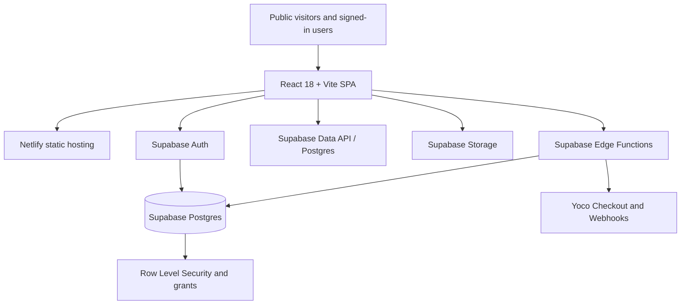
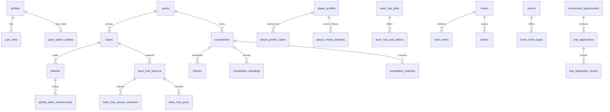

# CUT Sport — System and Data Architecture

**Version:** 0.1  
**Snapshot:** 25 November 2026  
**System:** CUT Sport web application  
**Repository branch:** `App`  
**Supabase project reference:** `tnkykdfxzwaqzbichxcl`

## 1. Purpose and scope

This document describes the application architecture and the connected Supabase public-schema data model observed during the 25 November 2026 technical review. It is intended to help Central University of Technology ICT understand the components, data domains, trust boundaries and integrations before a formal security and operational assessment.

The document describes the observed design; it does not certify that every feature is production-ready or that every control has passed runtime testing.

## 2. High-level architecture

### Main components

| Layer | Observed implementation | Responsibility |
|---|---|---|
| User interface | React 18.3.1, React DOM 18.3.1 | Public app, signed-in journeys and admin workspaces |
| Build and routing | Vite 6.4.1, React Router 6.28.0 | SPA bundling and client-side routes |
| Browser data client | `@supabase/supabase-js` 2.119.0 | Auth session, Data API and Storage access |
| Database | Supabase-managed PostgreSQL | Operational records, competition history and access policies |
| Authentication | Supabase Auth | User identity and access tokens |
| File storage | Supabase Storage | Private team media and public player profile photos |
| Server-side workflows | Supabase Edge Functions (Deno) | Payments, ticket issuance/redemption and scoped reports |
| Static hosting | Netlify | Publishes the built `dist` SPA |
| Payment provider | Yoco | Hosted checkout and signed payment webhooks |

## 3. Frontend configuration

The browser Supabase client is created in `src/lib/supabase.js`. It reads:
- `VITE_SUPABASE_URL`
- `VITE_SUPABASE_PUBLISHABLE_KEY`

The checked-in `.env.example` contains placeholders only. The browser client uses a publishable key, persists the user session and enables token refresh. No service-role key is present in this frontend client file.

Package versions observed in `package.json`:
- React / React DOM: 18.3.1
- Vite: 6.4.1
- Supabase JS: 2.119.0
- React Router DOM: 6.28.0
- Lucide React: 0.468.0

Build command: `npm run build`. The Netlify build configuration publishes `dist`, uses Node.js 22 and redirects SPA routes to `/index.html`.

## 4. Core data domains

The connected `public` schema contains **67 base tables and 2 views** at the time of inspection. There are **178 foreign-key constraints** in the schema. The inventory below is grouped by business purpose; table names are the authoritative identifiers.

### 4.1 Identity, user roles and staff assignments

- `profiles` — application profile linked to Supabase Auth.
- `user_roles` — application role assignments, unique per user and role.
- `sport_admin_profiles`, `sport_admin_assignments` — administrator identity and scoped sport/team assignments.
- `team_staff_profiles` — public-facing staff profiles associated with sports and teams.

### 4.2 Sport, team and competition directory

- `sports`, `teams`, `competitions`, `fixtures`
- `competition_matches`, `competition_standings`
- `competition_squads`, `competition_squad_members`
- `competition_player_statistics`, `competition_team_statistics`
- `team_fixture_tallies` (view)

These records support the public sport directory, team pages, fixture calendar, competition profiles, historical seasons and team performance summaries.

### 4.3 Athlete and canonical player identity

- `athletes` — institution/team-facing athlete records and approval state.
- `player_profiles` — canonical public player identity and claim state.
- `player_profile_claims` — requests to claim a canonical profile.
- `athlete_team_memberships`, `athlete_competitions`
- `athlete_statistics`, `athlete_achievements`, `athlete_media`
- `athlete_review_history`, `athlete_player_profile_link_audit`
- `athlete_data_quality_reviews`, `athlete_data_quality_review_history`
- `player_profile_records` (view)

The design separates a team/athlete operational record from a canonical player profile. The profile-link audit and claim workflow are intended to reduce incorrect identity matching. Approval state determines which athlete information is publicly surfaced.

### 4.4 Player history, honours and international representation

- `player_match_statistics`, `player_match_statistics_review_history`
- `player_international_appearances`
- `player_awards`
- `competition_honours`

These records support verified match appearances, individual statistics, international appearances and team competition honours. Source URLs and review/approval fields are present on key history records. Data completeness and identity matching still require human source verification.

### 4.5 Team Hub, season management and media

- `team_hub_seasons`, `team_hub_season_members`
- `team_hub_posts`, `team_hub_polls`, `team_hub_poll_options`, `team_hub_poll_responses`
- `team_hub_practice_attendance`, `team_hub_fixture_attendance`
- `team_hub_player_availability`, `team_hub_player_development_notes`
- `team_hub_media_assets`, `team_hub_social_content`
- `coach_action_tasks`, `coach_action_task_history`
- `report_export_history`

Season records retain historical squads and support active and completed team hubs. Availability is intended as a limited operational availability signal; it must not become a repository for diagnoses, treatment notes or clinical records. Development notes, attendance and availability require strict team scope and retention controls.

### 4.6 Recruitment and trials

- `recruitment_opportunities`
- `trial_applications`
- `trial_evaluation_criteria`
- `trial_application_scores`
- `trial_application_reviews`

This domain supports recruitment notices, applications, assessment criteria, scoring and review history. Trial scoring and private evaluation notes are sensitive and should remain restricted to authorised staff.

### 4.7 News, events, communication and notifications

- `articles`, `article_comments`
- `events`, `event_rsvps`
- `athlete_messages`, `notifications`
- `sponsors`

### 4.8 Shop, event tickets and payment records

- `products`
- `orders`, `order_items`
- `event_ticket_types`, `tickets`
- `yoco_webhook_events`

Orders distinguish shop and event checkout. Payment status, provider references, checkout identifiers and webhook event identifiers support reconciliation and idempotency. Payment card data is expected to remain with the payment provider; ICT must confirm that no cardholder data is collected or stored by CUT Sport.

### 4.9 Audit and administration support

- `sport_admin_activity_logs`
- `fixture_result_submissions`
- `athlete_review_history`
- `athlete_data_quality_review_history`
- `player_match_statistics_review_history`
- `report_export_history`

These records provide review, submission, export or administrative history. ICT should confirm retention periods, tamper resistance and access to audit data.

## 5. Key relationship map

The following is a simplified logical view, not a replacement for the live constraint catalogue.

The database also uses composite foreign keys to ensure that related team, sport and season identifiers remain consistent. For the authoritative relationship list, ICT should inspect `pg_constraint` on the connected project and the matching migration files.

## 6. Storage architecture

Two buckets were observed:

| Bucket | Visibility | File limit | Allowed types | Intended use |
|---|---|---:|---|---|
| `cut-sport-media` | Private | 50 MiB | JPEG, PNG, WebP, GIF, MP4, QuickTime, WebM, PDF | Team/season media and approved staff assets |
| `player-profile-photos` | Public | 50 MiB | JPEG, PNG, WebP | Public player profile photographs |

The private media bucket should use authenticated, scope-checked policies and short-lived signed URLs for previews/downloads. The public photo bucket requires moderation, content ownership, takedown and consent procedures. Storage policy testing is required; bucket visibility alone does not prove that object-level policies are correct.

## 7. Server-side workflows and integrations

| Function | Purpose | Security characteristics observed |
|---|---|---|
| `yoco-checkout` | Authenticated checkout creation | Validates bearer session with `auth.getUser()`; uses service key only server-side; validates HTTPS app URL and Yoco checkout response; uses idempotency key |
| `yoco-webhook` | Payment reconciliation and ticket issuance | Verifies webhook HMAC signature and timestamp; reconciles checkout/order amount and currency; uses service key server-side |
| `my-tickets` | Return tickets belonging to signed-in user | Validates session and filters tickets by authenticated user ID; validates signed ticket token |
| `redeem-ticket` | Event entry validation | Validates signed ticket code; checks sport-admin assignment or super-admin role; conditional redemption prevents double use |
| `event-report` | Event sales and attendee report | Validates session and role; scopes sport administrators to assigned sports; intentionally omits attendee contact and student-number fields |
| `manage-shop-order` | Shop order fulfilment transitions | Validates session and shop-admin/super-admin role; only paid shop orders; calls a controlled status-transition RPC |

The functions use server-side environment secrets. Service-role credentials must never be placed in browser variables, committed files or logs.

## 8. Data flow examples

### Public competition and heritage read

1. Visitor opens the React SPA.
2. Browser client uses the Supabase publishable key.
3. Data API request reaches PostgreSQL.
4. Grants and RLS determine which public competition/season/history rows are visible.
5. The two reporting views use `security_invoker=true`, so view queries respect the caller's permissions on underlying tables.

### Staff changes a team record

1. Staff signs in through Supabase Auth.
2. Frontend obtains the current user session and assigned role context.
3. Admin dashboard displays only the modules appropriate to the role in the current frontend code.
4. Data API operation is independently evaluated by RLS and grants; frontend navigation is not an authorisation boundary.
5. Scoped operations must verify sport/team assignment and write audit/review history where applicable.

### Yoco checkout and webhook

1. Signed-in user requests checkout.
2. `yoco-checkout` validates the user's JWT, order request and configured secrets.
3. Server-side database RPC prepares an idempotent order and reserves the relevant stock/ticket inventory.
4. Function creates hosted Yoco checkout and stores the provider checkout reference.
5. Yoco sends a webhook; `yoco-webhook` validates signature and timestamp before reconciling the payment.
6. Successful event-ticket orders receive signed ticket codes; duplicate webhook events are protected through event identifiers and idempotent operations.

## 9. Hosting and release

Observed Netlify configuration:
- Build command: `npm run preflight:deploy && npm run build`
- Publish directory: `dist`
- Node.js: 22
- SPA fallback: all routes redirect to `/index.html`
- Headers include `X-Content-Type-Options: nosniff`, `Referrer-Policy: strict-origin-when-cross-origin`, and a restrictive Permissions Policy for camera/microphone/geolocation.

The published site is known as `https://cutsportapp.netlify.app`. The last previously observed Netlify notice indicated production deploys and Agent Runners were paused due operational-credit limits. This snapshot did not re-check Netlify billing or deployment state; ICT must verify the current hosting console before release.

## 10. Data classification and handling recommendations

| Data class | Examples | Recommended handling |
|---|---|---|
| Public institutional/sport data | Published fixtures, competition tables, approved statistics, public news | Public read only after publication approval |
| Internal operational data | Staff assignments, draft fixtures, draft content, task lists | Authenticated role and scope restrictions |
| Personal information | Names, email, phone, student number, athlete profile, team membership | Purpose limitation, minimisation, access logging, correction and retention controls |
| Sensitive operational records | Trial scores, private development notes, availability, attendance, direct messages | Need-to-know access, explicit retention, audit and restricted exports |
| Payment and ticket data | Order IDs, amounts, payment references, ticket hashes | Reconciliation, fraud prevention, restricted access; no card data storage |

POPIA applicability, lawful basis, responsible-party/operator roles, notices, retention, cross-border processing and data-subject workflows must be assessed by CUT's Information Officer and legal/privacy team. This document does not claim POPIA compliance.

## 11. Current technical snapshot

- 67 public-schema base tables observed; all 67 have RLS enabled.
- 0 public-schema base tables observed with RLS disabled.
- 203 public-schema RLS policies across 67 tables.
- 178 foreign-key constraints.
- 2 public-schema views; both have `security_invoker=true`.
- 2 Supabase Storage buckets; one private and one public.
- 6 Edge Functions listed above.
- 3 public-schema `SECURITY DEFINER` functions; see the security review document.
- GitHub CI and frontend build passed for dashboard commit `c6d1ad138806a31632fd61fd69753be46a76a673`.

## 12. Items requiring ICT confirmation

1. Confirm production project ownership, region, database version, support plan and administrative access.
2. Confirm backup/PITR configuration and perform a restore drill.
3. Reconcile local migration files with remote migration history before any schema deployment.
4. Validate all RLS policies using anonymous, authenticated, player, coach, team-manager, sport-admin, shop-admin and super-admin test identities.
5. Review private/public Storage policies and object lifecycle.
6. Validate Edge Function secrets, CORS origin policy, rate limiting and operational monitoring.
7. Complete Yoco test/live environment verification and payment reconciliation tests.
8. Complete privacy impact assessment and POPIA review.
