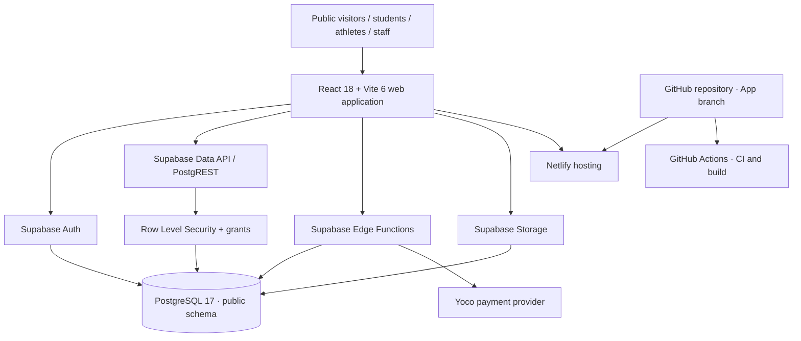

# CUT Sport — System and Data Architecture

**Document owner:** CUT Sport project team  
**Review audience:** CUT ICT, Information Security, Data Protection / Information Officer, application support  
**Snapshot date:** 25 November 2026  
**Status:** Architecture baseline for ICT review; not a security certification.

## 1. Executive summary

CUT Sport is a React single-page application using Supabase for authentication, PostgreSQL data, Row Level Security (RLS), object storage and Edge Functions. It supports public sport information and historical competition records, athlete/player profiles and career records, staff/team operations, content and events, recruitment, team-season collaboration, shop orders and event tickets.

The live Supabase project is named **CUT Sport**, hosted in region `sa-east-1`, with PostgreSQL 17. The `public` schema contains **67 tables**, 784 columns and 179 declared foreign-key constraints. All 67 inspected public tables have RLS enabled. RLS is not forced on table owners, so privileged database roles and service credentials remain a separate trust boundary.

## 2. Logical architecture

This is a logical view. Exact runtime configuration, production deploy status, provider secrets and network controls must be confirmed with the relevant platform administrators.

## 3. Core domain model

- **Identity and roles:** Supabase Auth identities are represented in `public.profiles`; `user_roles` stores application roles. Sport administrators and team staff receive scoped assignments through `sport_admin_profiles`, `sport_admin_assignments` and `team_staff_profiles`.
- **Sport structure:** `sports` is the parent catalog for `teams`, `competitions`, fixtures and sport-specific operational data.
- **Competition history:** competitions connect to standings, matches, team/player statistics, squads and squad members. This supports public current/previous season and heritage views.
- **Athlete and player identity:** `athletes` stores CUT athlete records; `player_profiles` stores canonical player identities; claims and link-audit tables support ownership and reconciliation. Athlete team memberships and career tables record sport/team participation, achievements, international appearances and awards.
- **Team operations:** team hub seasons connect squads, posts, polls, attendance, development notes, availability, social content, media and report exports. Coach action tasks and history provide workflow tracking.
- **Publishing and events:** articles, comments, events, RSVPs, sponsors and notifications support public content and communication.
- **Recruitment:** opportunities connect to applications, reviews, evaluation criteria and scores.
- **Commerce:** products, orders and order items support the shop; events, ticket types and tickets support admission; Yoco webhook event records support payment reconciliation.

## 4. Data-flow principles

1. Public pages read only records exposed by public-facing policies (for example approved/public athlete and competition content). Public visibility must be tested independently of whether a user is signed in.
2. Authenticated requests use the Supabase session JWT. Database policies should derive identity from `auth.uid()` and verify role plus assigned sport/team scope.
3. Staff writes to athlete, match and competition records follow review/approval workflows where configured. Approval and review-history tables are separate from public display data.
4. Payment creation, webhook processing, ticket redemption and order transitions are implemented through Edge Functions and/or restricted database functions; secret provider credentials must remain server-side.
5. Private media is stored in a non-public bucket and must be accessed through authorized storage policies or short-lived signed URLs.

## 5. Platform and source-control baseline

- Frontend: React 18.3.1, React DOM 18.3.1, React Router 6.28.0, Vite 6.4.1, Supabase JS 2.119.0.
- Runtime used in GitHub workflows: Node.js 22.
- Repository: `siphenda-hue/CUTSportAppRep`, branch `App`.
- Hosting target: Netlify site `https://cutsportapp.netlify.app`. The site was previously reported published while production deploys/Agent Runners were paused for operational credits; current deployment controls and billing state require confirmation.
- Supabase project region: `sa-east-1`; database engine PostgreSQL 17.
- Latest dashboard commit at snapshot: `c6d1ad138806a31632fd61fd69753be46a76a673`. GitHub Actions CI and frontend build passed for that commit.

## 6. Important architecture constraints

- Do not duplicate existing tables or create a parallel admin system.
- Do not expose Supabase service-role keys or payment secrets in browser code, GitHub source or public documentation.
- Keep public and authenticated access separated by RLS and database grants; frontend role checks are usability controls only.
- Treat student identifiers, contact details, athlete records, staff notes, messages, trial scores and attendance as protected information.
- Do not store medical diagnoses or treatment details in player availability fields.
- Apply schema changes through reviewed, versioned migrations only after the migration-history discrepancy in the risk register is resolved.

## 7. Related documents

- [Database schema inventory](02-database-schema-inventory.md)
- [Security architecture and findings](03-security-architecture-and-review.md)
- [Role access matrix](04-role-access-matrix.md)
- [Infrastructure and integrations](05-infrastructure-and-integrations.md)
- [Risk register and ICT checklist](06-risk-register-and-ict-checklist.md)
- [ICT review memorandum](07-ict-review-memorandum.md)

## 8. Limitations

This baseline is generated from the source repository and live Supabase catalog at the snapshot date. It does not constitute penetration testing, legal advice, a POPIA compliance opinion, a disaster-recovery test, payment-provider certification or confirmation that every screen and policy has been end-to-end tested.
